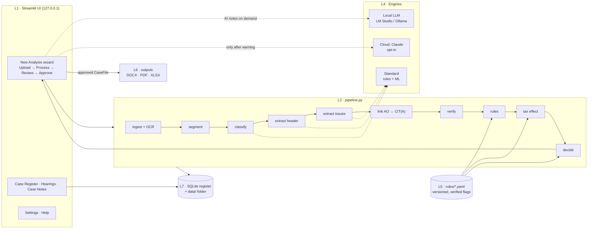

# AppealIQ — ITAT Appeal Readiness Analyser

**Reads an appealable income-tax order and produces a verified, para-referenced ITAT appeal readiness report, draft grounds, paper book index and issue register — offline, in minutes, for a CA to review and approve.**

Version 1.0.0 (compiled submission edition) · Python 3.14 (64-bit) · Windows 11 · ICAI AICA Level 2 capstone · CA Kiran Sanmane

One-click installer: <<INSTALLER_LINK>> (coming soon) · Demo video: <<VIDEO_LINK>>

*(screenshot: Home dashboard — in docs/screenshots.zip)*

---


> **Submission (compiled) edition.** The program core ships as compiled `.pyd` modules built for 64-bit **Python 3.14**; the knowledge base (`rules/appealiq_kb.dat`) and the AI prompt templates (`appealiq/engines/prompts.dat`) ship encrypted and are read by the compiled core. A one-click Windows installer (`<<INSTALLER_LINK>>`) is **coming soon**; until then, install with `setup.bat` as below. Run `setup.bat`, then `run.bat`.

## Contents

[Problem](#problem-statement) · [Solution](#solution-and-key-features) · [What's different](#what-makes-appealiq-different) · [Architecture](#architecture) · [Engines and privacy](#three-engines-and-the-privacy-model) · [Installation](#installation-windows-step-by-step) · [How to use](#how-to-use-in-4-steps) · [Sample outputs](#sample-outputs) · [Evaluation](#evaluation-summary) · [Controls and limitations](#controls-and-known-limitations) · [Future scope](#future-scope) · [AICA modules](#aica-level-2-modules-applied) · [How this was built](#how-this-was-built) · [Disclaimer](#disclaimer) · [Author](#author)

---

## Problem statement

When an order appealable to the Income Tax Appellate Tribunal (ITAT) arrives — a CIT(A) order u/s 250, a revision order u/s 263, a CIT(E) order u/s 12AB / 80G(5), or a final order u/s 143(3) r.w.s. 144C(13) — the practitioner has until the end of the second month after the month of communication (s. 253(3), w.e.f. 01-10-2024) to:

- trace every addition from the AO's order to its appellate outcome;
- decide which issues to carry to the ITAT, and which to concede;
- judge whether the Revenue is likely to appeal, given the CBDT monetary limit;
- decide on cross-objections;
- draft concise grounds and assemble the paper book.

Today this is done by hand across 50–150 pages of orders. Issues get missed, limitation dates slip, and the quality varies from one file to the next.

## Solution and key features

AppealIQ is a desktop web application (Python + Streamlit on `127.0.0.1`) that turns those orders into a reviewed decision report and filing kit.

| Feature | What it does |
|---|---|
| **Issue trail** | Links each AO addition to the CIT(A) ground and its outcome — allowed, partly allowed, dismissed, restored — with AO, relief and sustained amounts. |
| **Verification** | Every extract carries page, para and a verbatim snippet, checked word for word against the source. Anything that fails is marked UNVERIFIED and kept out of the outputs unless the reviewer confirms it. |
| **Limitation and fee** | Form 36 due date (two months from the end of the month of service; 60 days for orders served before 01-10-2024), cross-objection window, RAG status, s. 253(6) fee — all from YAML rules. |
| **Tax effect** | Per-issue rate, with additions u/s 68–69D taxed u/s 115BBE; assessee's and Revenue's tax effect; Revenue's likelihood of appeal against the **CBDT monetary limit** (₹60 lakh for the ITAT) and its exceptions. |
| **Decision matrix** | Appeal / Appeal balance / Accept / Evaluate / Monitor per issue, with priority and a templated rationale; reviewer overrides are kept. |
| **Draft grounds** | Legal grounds first, exact amounts and sections, "craves leave" clause; editable. |
| **Consequential matters** | Order giving effect and estimated revised demand, penalty u/s 270A / 271AAC, interest, stay of demand. |
| **Case Register with hearings** | Every case in SQLite: ten statuses, date of filing, ITA No., hearing log, next hearing on the Home dashboard. |
| **Case Notes** | Points, pending points, remarks, arguments and the firm's own case laws per case; optional internal annexure. |
| **Case Laws in Orders** | Citations found in the AO order, the CIT(A) order and the submissions — case name, citation, court, relied on by, para — quoted, never summarised by AI. |
| **Supporting uploads** | Form 35, statement of facts and submissions; Form 35 grounds identify issues when the order does not list them. |
| **On-demand local AI notes** | A summary and strategy note per adverse issue from a model on this computer (LM Studio / Ollama), labelled "AI-generated — advisory". |

Outputs: **ITAT Appeal Readiness Report** (DOCX + PDF), **Draft Grounds of Appeal** (DOCX), **Paper Book Index** (DOCX), **Issue Register** (XLSX).

## What makes AppealIQ different

- **ITAT-stage focus.** Built for the one decision point most tools ignore: what to do after the CIT(A) order, within the limitation period.
- **AO → CIT(A) issue trail.** Reads both orders and links them; an AO addition missing from the appellate order is flagged.
- **Revenue tax effect vs the monetary limit.** Estimates whether the Department can and is likely to appeal, which decides whether to file cross-objections.
- **Verified, para-referenced extracts.** Every fact can be traced to a page and para; nothing unverified reaches the report silently.
- **Offline-first, with local AI.** Standard and Local modes send nothing off the machine. Cloud AI is opt-in, per case, behind a confidentiality warning.
- **No AI-written case law.** The app never invents or suggests judgments. It only quotes citations that appear in the uploaded documents or that the user enters.

## Architecture



Business logic never imports Streamlit; every stage is wrapped so a failure becomes a plain-English message, never a crash. Dates, fees, tax effect, monetary limits and RAG status are computed **only** by Python from `rules/`. Details: [docs/ARCHITECTURE.md](docs/ARCHITECTURE.md).

## Three engines and the privacy model

| Engine | Where it runs | Used for | Data leaves the machine? |
|---|---|---|---|
| **Standard** (default) | This computer | All extraction, classification, verification, rules, tax effect and decisions | **No** |
| **Local AI** — LM Studio or Ollama | This computer (`localhost:1234` / `localhost:11434`) | Optional AI summary and strategy note per issue; optional ground-title polish | **No** |
| **Cloud AI** — Claude (Anthropic API) | Anthropic | Same optional notes, for firms that permit it | **Yes** — only after a per-case confidentiality warning is accepted; the report records "Cloud processing used" |

Privacy controls: Streamlit bound to `127.0.0.1`; usage statistics off; no CDN fonts or scripts; the API key is never logged; a test scans the source for any URL other than localhost and the Anthropic API host. If an AI engine is unavailable or returns invalid output, the Standard result stands and a notice is shown.

## Installation (Windows, step by step)

Tested on Windows 11 (8 GB RAM). macOS / Linux: use `setup.sh` and `run.sh`.

1. **Python 3.12 (64-bit)** — install from python.org (keep "py launcher" ticked) or run:
   ```bash
   winget install Python.Python.3.12
   ```
2. **Git** —
   ```bash
   winget install Git.Git
   ```
3. **Tesseract OCR 5** (optional, for scanned orders) — install the Windows build from the UB Mannheim Tesseract page into `C:\Program Files\Tesseract-OCR` and tick the **Hindi** language data. AppealIQ finds it automatically; without it, text PDFs still work and scanned pages are flagged.
4. **Local AI** (optional) — either:
   - **LM Studio**: download a model such as `gemma-3-12b-it`, open the *Developer* tab and start the server (port 1234); or
   - **Ollama**: `ollama pull gemma3:12b` (port 11434), then pick the Ollama preset in Settings.
5. **Get the code**:
   ```bash
   git clone <repository-url> AppealIQ
   ```
6. **Run setup** — double-click `setup.bat` (or run it in a terminal). If Python 3.12 is missing it uses a newer standard (not free-threaded) Python with a warning. It creates `.venv`, installs the pinned packages, checks Tesseract, builds the sample orders and trains the classifier, and creates the **AppealIQ** desktop shortcut.
   ```bash
   setup.bat
   ```
7. **Start** — double-click the **AppealIQ** icon on the desktop. The app opens in its own Microsoft Edge window; closing the window stops it. (Alternatively run `run.bat`, which opens your default browser at `http://127.0.0.1:8501`.)
8. **Settings** (first run) — enter your firm name and reviewers; under *Local AI* press **Test connection**. *Advanced (administrator)* shows the health check.

## How to use (in 4 steps)

**Step 1 — Upload and details.** Upload the order appealed against and, ideally, the AO's order; add Form 35 or submissions if you have them. Enter the case ID, client, **date of service** (mandatory) and the assessee's tax rate. *Process* stays disabled until the inputs are valid.

*(screenshot: Step 1 — in docs/screenshots.zip)*

**Step 2 — Processing.** Each stage shows its status and time; S2 + S1 takes under a second. A warning comes with a corrective action and *Retry this step*.

*(screenshot: Processing — in docs/screenshots.zip)*

**Step 3 — Review and edit.** Work through the tabs: Order Details, **Issue Trail**, **Tax Effect**, **Decision Matrix**, Grounds & Paper Book, Verification Log, Case Notes, Case Laws in Orders and Hearings. Any edit — an outcome, a rate, a recommendation — re-runs the rules, tax effect and decisions at once.

| Issue trail | Tax effect |
|---|---|
| *(screenshot: Issue trail — in docs/screenshots.zip)* | *(screenshot: Tax effect — in docs/screenshots.zip)* |
| **Decision matrix** | **Local AI note (on demand)** |
| *(screenshot: Decision matrix — in docs/screenshots.zip)* | *(screenshot: AI note — in docs/screenshots.zip)* |

**Step 4 — Approve and download.** Tick the approval box and enter the reviewer's name; only then are the report, grounds, paper book index and issue register generated. The case moves to the **Case Register**, where filing, ITA No. and hearings are tracked.

| Approve and download | Case Register |
|---|---|
| *(screenshot: Approve — in docs/screenshots.zip)* | *(screenshot: Case Register — in docs/screenshots.zip)* |

*Try it:* upload `samples/S2_CITA_order_AY2022-23.pdf` as the main order and `samples/S1_assessment_order_AY2022-23.pdf` as the AO order, date of service 20-10-2026, rate "Company u/s 115BAA". Expected: 4 issues, Form 36 due 31-12-2026, assessee's tax effect ₹3,02,016, Revenue's ₹37,11,344 (unlikely to appeal — below the ₹60 lakh limit).

## Sample outputs

All from fictitious sample orders.

| Case | Report | Grounds | Paper book | Issue register |
|---|---|---|---|---|
| CIT(A) order + AO order (S2 + S1) | DOCX (in docs/sample_outputs.zip) · PDF (in docs/sample_outputs.zip) | DOCX (in docs/sample_outputs.zip) | DOCX (in docs/sample_outputs.zip) | XLSX (in docs/sample_outputs.zip) |
| Revision order u/s 263 (S4) | DOCX (in docs/sample_outputs.zip) · PDF (in docs/sample_outputs.zip) | DOCX (in docs/sample_outputs.zip) | DOCX (in docs/sample_outputs.zip) | XLSX (in docs/sample_outputs.zip) |

## Evaluation summary

Full results: [docs/EVALUATION.md](docs/EVALUATION.md) (regenerate with `python scripts/evaluate.py`).

| Measure | Result |
|---|---|
| Field accuracy, 8 synthetic orders (header / issues / outcomes) | 100% / 100% / 100% |
| Scanned copy of S2 read by OCR (header / issues / outcomes) | 88.9% / 100% / 100% |
| Extracts verified against the source (full pipeline) | 130 / 130 |
| Standard engine, S2 + S1 end to end | ≈ 0.2 s |
| 40-page / 300-page text order | ≈ 1.2 s / ≈ 8 s (target ≤ 30 s for 40 pages) |
| OCR | ≈ 2.5 s per page (target ≤ 6 s) |
| Local AI note (gemma-3-12b-it, laptop) | 62–106 s per issue, on demand |
| Hardening: 11 bad inputs (non-PDF, encrypted, blank, 300 pages, AI server down, bad key …) | 0 crashes; every message says how to fix it |
| Automated tests | 671 passing; coverage of `appealiq/` (excluding UI) ≈ 93% |

> **Honest note.** The 100% scores are on **synthetic** orders generated from the templates the patterns were written for; they prove the pipeline end to end, not accuracy on real orders. **Real-order trial (owner, offline):** one real redacted NFAC CIT(A) order was tested. Automatic issue detection did not succeed (**DF-001, open**). Workaround: issues can be added manually or taken from an uploaded Form 35; all downstream analysis (limitation, tax effect, decisions, grounds, report, case register) works on them. Next step: layout-specific patterns using the masked diagnostic tool.

## Controls and known limitations

**Controls**

- **Human in the loop** — outputs are locked until a named reviewer approves; any later edit withdraws the approval.
- **Deterministic law** — forum, limitation, fee, tax effect, monetary limit and RAG come only from versioned YAML rules; each entry carries `verified`, source and reviewer, and the report annexes the provisions applied.
- **Never fabricate** — missing values show "Not found"; unverified extracts are excluded unless confirmed; the verification log records every correction.
- **AI is advisory** — AI text is labelled, limited to the issue's own amounts and sections, rejected if it cites a case, and never changes an outcome, amount or date.
- **Graceful degradation** — no OCR, no AI server, a bad key or a bad file each produce a clear notice, not a crash.

**Known limitations**

1. **DF-001 (open):** automatic issue detection failed on a real NFAC CIT(A) order. Use *Add issue manually* or *Use grounds from Form 35* in Review → Issue Trail.
2. Accuracy is proven on synthetic orders only; real-order layouts vary.
3. 42 rules entries are `verified: false` (28 new rate presets, 7 forum / limitation entries incl. the Income-tax Act, 2025 seed, 6 validity checks, holidays) and are flagged in the app and the report.
4. Orders under the Income-tax Act, 2025 are detected and bannered, but their forum, limitation and fee use unverified seed rules.
5. OCR reads some header fields less reliably (S6 header 88.9%); Hindi OCR needs Tesseract's `hin` data.
6. Local AI notes take about a minute per issue on a laptop-class model; they are optional.
7. PDF output needs Microsoft Word or LibreOffice; otherwise the DOCX is provided.
8. Single user, single machine; no portal filing or cause-list tracking.

## Future scope

- **Real-order layout library** — layout-specific patterns built from masked diagnostics (`scripts/diagnose_pdf.py`), starting with DF-001.
- **Income-tax Act, 2025 block** — verified forum, limitation (s. 362), Forms 115 / 116 and section mapping.
- **Curated case-law library** — the firm's own verified judgments, searchable per issue (never AI-generated).
- **High Court stage** — appeals u/s 260A on substantial questions of law.
- **GST appeals** — the same approach for GSTAT appeals.
- **MCP server** — expose the deterministic rules (limitation, fee, tax effect) as tools for AI assistants.

## AICA Level 2 modules applied

| Module | Where in AppealIQ |
|---|---|
| **Offline LLMs via LM Studio** | `engines/lmstudio.py` — OpenAI-compatible local server (LM Studio / Ollama), strict JSON schema, retries, fallback; tested with gemma-3-12b-it. |
| **Computer vision / OCR** | `ingest.py`, `textquality.py` — PyMuPDF page rendering at 300 dpi, Tesseract OCR with confidence, garbled-text-layer detection. |
| **Python** | The whole application: pydantic models, scikit-learn classifier, rapidfuzz verification, python-docx / openpyxl outputs, SQLite register, pytest. |
| **AI agents and Claude Code (AI-assisted development)** | Built phase by phase with Claude Code from a written specification; every prompt logged. |
| **MCP (optional)** | Designed for: the rules engine is pure Python and can be wrapped as an MCP server (future scope). |

## How this was built

Spec-driven, phase-gated development with **Claude Code**:

1. A product specification ([docs/SPEC.md](docs/SPEC.md)) and standing rules ([CLAUDE.md](CLAUDE.md)) written first.
2. Fourteen phases ([docs/PROMPTS.md](docs/PROMPTS.md)), each planned, built, tested and reviewed before the next; review findings became numbered change requests (CR-001 … CR-009) recorded in the spec.
3. Every prompt, outcome and issue logged in [docs/PROMPT_LOG.md](docs/PROMPT_LOG.md).
4. Design document: [docs/AppealIQ_MADD_v1.7.docx](docs/AppealIQ_MADD_v1.7.docx). Demo script: [docs/DEMO_SCRIPT.md](docs/DEMO_SCRIPT.md). Submission steps: [docs/SUBMISSION.md](docs/SUBMISSION.md).

```bash
pytest -q --cov=appealiq
```

## Disclaimer

"AppealIQ is a decision-support tool. Its outputs are drafts for review by a qualified professional. They do not constitute legal or tax advice. Statutory provisions, limitation periods, fees and CBDT instructions applied by the tool are configurable and must be verified against the current law before reliance. All sample data in this repository is fictitious."

## Author

**CA Kiran Sanmane** — K. B. Sanmane & Co.
ICAI membership no. 151331 · AICA Level 2, Batch 100, Pune

Demo video: <<VIDEO_LINK>>
