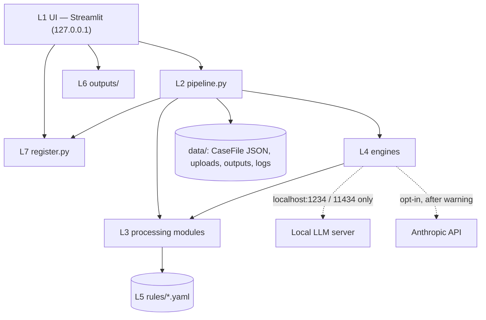
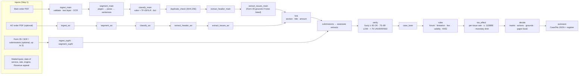
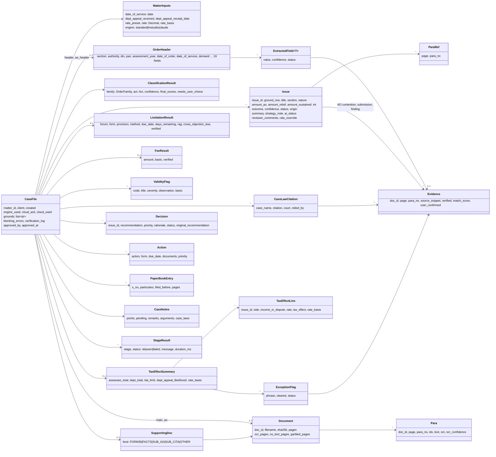

# AppealIQ — Architecture

Version 1.0.0. Companion to [SPEC.md](SPEC.md) §4–§9 (the source of truth) and the [README](../README.md).

## 1. Layers

| Layer | Modules | Responsibility | May import |
|---|---|---|---|
| **L1 UI** | `app.py`, `appealiq/ui/*` (`nav`, `theme`, `page_home`, `page_new`, `review`, `hearings`, `case_notes`, `ai_notes`, `page_register`, `page_settings`, `page_help`, `state`) | Streamlit pages, wizard, review tabs, approval gate. Only this layer imports Streamlit and `st.session_state`. | `pipeline`, `register`, `config`, `outputs` |
| **L2 Orchestration** | `pipeline.py` | Runs the stages in order, wraps each in `run_stage` (→ `StageResult` ok / warn / failed), progress callbacks, background jobs (`PipelineJob`, `AINotesJob`), edits + `recompute`, reprocess, autosave, health check. | L3–L7 |
| **L3 Processing** | `ingest`, `textquality`, `segment`, `classify`, `extract_header`, `extract_issues`, `link`, `verify`, `caselaw`, `rules_engine`, `tax_effect`, `consequential`, `decide`, `fmt` | Pure functions over pydantic models. No I/O beyond reading the PDF; no Streamlit; no network. | models, rules |
| **L4 Engines** | `engines/base` (protocol), `standard`, `llm` (shared LLM logic), `lmstudio`, `claude`, `prompts/*.md` | Classification and extraction (Standard); optional AI notes and ground-title polish (LLM). Only `lmstudio` and `claude` may import network libraries (a test enforces it). | L3 |
| **L5 Knowledge base** | `rules/*.yaml` | Forum and limitation, fees, monetary limits, validity checks, actions, patterns, holidays, rates, glossary, checklists, consequential notes. Versioned; each entry `verified` with source and reviewer. Loaded once and validated by pydantic. | — |
| **L6 Outputs** | `outputs/styles`, `report_docx`, `grounds_docx`, `paperbook_docx`, `register_xlsx`, `matters_xlsx`, `pdf_convert` | Built only from an **approved** `CaseFile` (`require_approved`). PDF via Word → LibreOffice → "DOCX provided". | models |
| **L7 Storage** | `register.py`, `config.py`, `data/` | SQLite case register (`matters`, `documents`, `hearings`), CaseFile JSON per case, uploads, outputs, rotating logs; settings in `config/settings.yaml`. | — |

## 2. Pipeline

| Stage | Module | Key behaviour |
|---|---|---|
| ingest | `ingest.py`, `textquality.py` | Rejects non-PDF / encrypted / blank files with a fix. OCR (Tesseract, 300 dpi) when a page has < 50 chars, a garbled layer, or is mostly image; OCR replaces the layer only if it reads better. |
| segment | `segment.py` | Strips headers / footers / page numbers; para numbering variants; unnumbered structural headings ("Decision", "Ground No. 2") open their own para. |
| classify | `classify.py` | Rule score ÷ family total (0.6) + TF-IDF / logistic regression (0.4); below 0.55 → UNKNOWN; Income-tax Act 1961 / 2025 detection. An AO order as the main order is blocked. |
| extract | `extract_header.py`, `extract_issues.py` | DIN, PAN, AY, dates, authority, incomes, demand; issue blocks per order family (ground headings, upfront grounds lists, "Issue No." headings, one Decision section); roles by cue words + a roles model + TextRank; outcome from operative sentences (last 30% weighted × 2); amounts per outcome. |
| link | `link.py` | AO addition ↔ appellate ground: section 0.5, title similarity 0.3, amount ± 1% 0.2; accept ≥ 0.6; legal grounds unlinked but not flagged; unmatched AO additions flagged. |
| verify | `verify.py` | Every snippet searched at the stated para → ± 2 paras → page → whole document; references auto-corrected and logged; UNVERIFIED items excluded downstream unless confirmed. |
| rules | `rules_engine.py` | Forum, form (36 / 36A), limitation by method (`months_from_month_end` from 01-10-2024; 60 days before), cross-objections, non-working-day note, condonation, fee u/s 253(6), validity checks (e.g. DIN missing), RAG with injectable `today`. |
| tax effect | `tax_effect.py`, `consequential.py` | Assessee and Revenue tax effect at per-issue rates (68–69D at 78% u/s 115BBE); Revenue's likelihood of appeal vs the CBDT limit (≥ 1.0 × or an uncleared exception phrase → LIKELY; 0.8–1.0 × → POSSIBLE; < 0.8 × → UNLIKELY); revised demand, penalty and interest notes. |
| decide | `decide.py` | Decision rules 0–10 in strict priority; action plan from `actions.yaml` with dates; Rule 8 draft grounds; paper book index with evidence checklists. |
| AI notes (on demand) | `engines/llm.py`, `lmstudio.py`, `claude.py` | Short brief per adverse issue → summary ≤ 60 words + strategy note ≤ 80 words; rejected if it cites a case, a section outside the issue's group or an amount not the issue's own; labelled "AI-generated". Never changes a computed value. |

Every edit in Review calls `pipeline.recompute` (rules → tax effect → decide) and autosaves; it withdraws any earlier approval. `reprocess_case` reruns from the saved uploads and carries over notes, comments, rate overrides, user-added issues and hearings.

## 3. Data model

All structures that cross a module boundary are pydantic v2 models in `appealiq/models.py`. Money is `int` rupees (`Decimal` for rates); dates are `datetime.date`.

Field lists are abridged; see `models.py` for the full definitions. Golden-file models (`ExpectedSample`, `ExpectedHeader`, `ExpectedIssue`) are used only by tests and `scripts/evaluate.py`.

**Storage.** Each case is saved as `data/matters/<case-id>/casefile.json` (atomic write) and summarised in SQLite (`data/appealiq.db`): `matters` (status, AY, due date, RAG, filing date, ITA No.), `documents` (SHA-256 for duplicate detection) and `hearings` (date, bench, purpose, outcome, next date, remarks). Uploads live in `data/uploads/<case-id>/`, outputs in `data/outputs/<case-id>/`. `data/` is git-ignored.

## 4. Design rules that shape the code

1. **Deterministic law.** Only Python reading `rules/*.yaml` computes forum, limitation, fees, tax effect, monetary limit and RAG. LLM output is never an input to these.
2. **Never fabricate.** A missing value is `None` → "Not found". Unverified evidence never reaches an output unless the reviewer confirms it.
3. **Human in the loop.** `outputs` refuse a `CaseFile` without `approved_by`.
4. **Graceful degradation.** Every stage is wrapped; optional inputs (AO order, supporting documents, OCR, AI) never stop the run.
5. **Offline by default.** Network access is limited to `localhost` for the local LLM and the Anthropic host for opt-in cloud mode; a test scans the source for any other URL.
