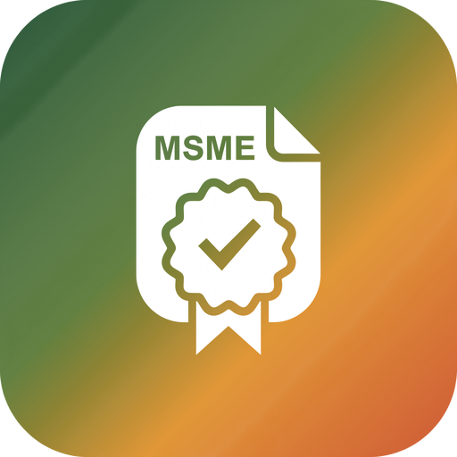
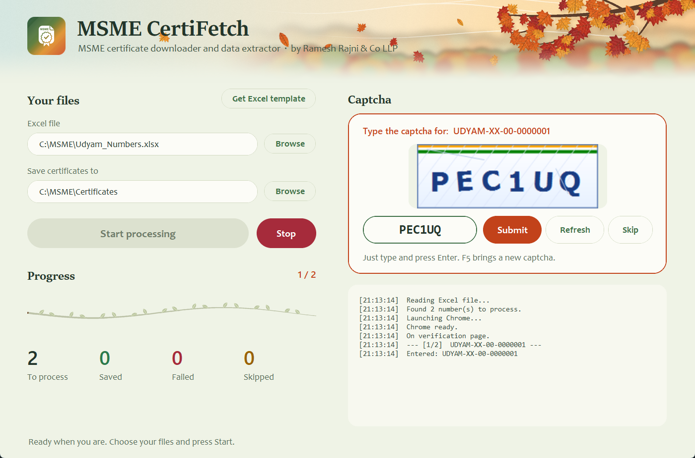
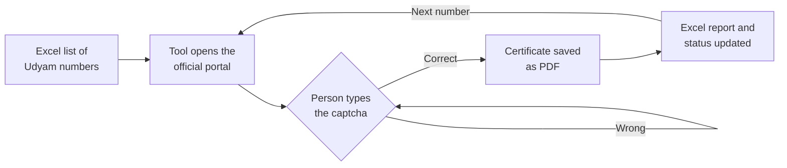
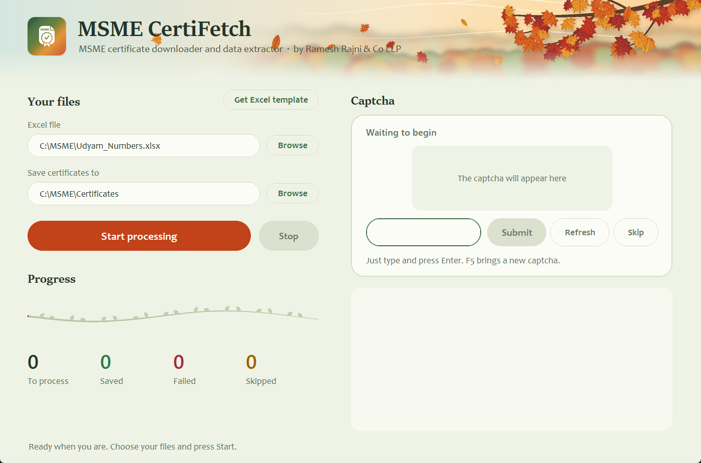
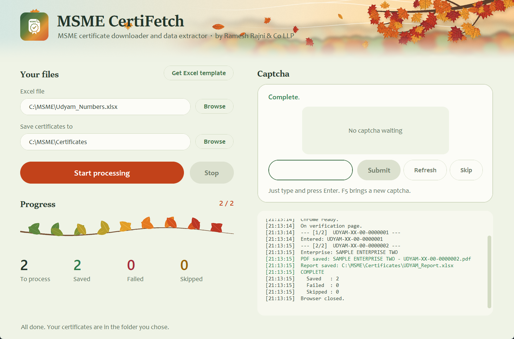

<p align="center">
  
</p>

<h1 align="center">
  
  MSME CertiFetch
</h1>

<p align="center"><strong>Verify Udyam registrations in bulk and save every certificate as a PDF.<br>You type the captcha. The tool does the rest.</strong></p>

<p align="center">Capstone project for the ICAI AICA Level 2 course, by Ronak Sanghavi (Batch B105), Ramesh Rajni &amp; Co LLP</p>

<p align="center">
  
</p>

## The problem

Under Section 43B(h) of the Income-tax Act and for MSMED Act reporting, auditors and accountants need to confirm the MSME status of vendors. Each check means opening the Udyam portal, typing a 19-character number, solving a captcha, saving the certificate, and copying the classification into a working paper. Across a long vendor list, this is slow, repetitive work where one copy-paste slip can go unnoticed.

## What it does

1. Reads a list of Udyam numbers from Excel.
2. Opens the official Udyam portal in Chrome and enters each number.
3. Brings the captcha to you. The cursor is already in the box, so you type and press Enter.
4. Saves the certificate as a PDF named after the enterprise.
5. Builds one Excel report with the enterprise name, major activity and latest two classification years.
6. Records Done, Failed, Skipped or Pending against each number, so a stopped run can continue later.



## A person stays in the loop

The captcha is how the portal confirms that a person is making each request. **This tool does not read, solve or bypass it.** A person types every captcha. The automation removes the work around that step: navigation, data entry, file naming and record keeping.

## Features

| Area | What you get |
|---|---|
| Getting started | **Get Excel template** creates the exact input format, with instructions and a check on the number format |
| Captcha | No mouse needed: the box is ready for typing, Enter submits, F5 fetches a new captcha |
| Wrong captcha | The portal's next captcha appears straight away, without reloading the page |
| Certificates | Saved using the portal's own print layout, one PDF per enterprise |
| Report | One row per number. It builds up across runs and never duplicates a number |
| Resilience | Up to 3 attempts per number. A portal failure costs that one number, not the whole run |
| Honest status | A certificate is marked Done only when its PDF was really written |
| Safe stop | Stop, or closing the window, ends Chrome and marks the current number Pending |

## Screens

| Choose your files | Results |
|---|---|
|  |  |

The picture-by-picture [Image Guide](docs/MSME_CertiFetch_Image_Guide.png) walks through the whole process.

## Try it

### Option 1: install it (no Python needed)

1. You need Windows 10 or 11, internet access and Google Chrome.
2. Run [`Installer/MSME_CertiFetch_Setup_v1.0.exe`](Installer/MSME_CertiFetch_Setup_v1.0.exe).
3. If Windows shows "Windows protected your PC", click **More info**, then **Run anyway**. The installer is not code-signed.

### Option 2: run from source

```
pip install -r requirements.txt
python src/MSME_CertiFetch.py
```

Then follow the [User Guide](docs/USER_GUIDE.md). A blank input file is in [`sample_data`](sample_data/Udyam_Numbers_Template.xlsx).

## Tests

Scenario tests run the real application logic against a simulated browser, with no portal traffic:

```
python tests/test_scenarios.py
```

They cover Done and Failed status, refresh limits, wrong captchas, PDF failures, portal failures, report merging, an open report file and the Excel template. The full flow was also checked by hand on the live portal from the installed app.

## How it is built

| Part | Technology |
|---|---|
| Interface | Python, CustomTkinter, Pillow |
| Browser automation | Selenium with Google Chrome |
| Excel | openpyxl |
| PDF | Chrome's own print engine |
| Windows installer | PyInstaller and Inno Setup (`src/Build_EXE.bat`) |

The artwork is generated in code by `src/Art/make_autumn_art.py`. The project was developed with AI-assisted coding (Claude Code), reviewed and tested by the author.

## Project structure

```
MSME-CertiFetch/
  README.md
  requirements.txt
  Installer/     Windows setup file
  src/           application, artwork and build scripts
  docs/          user guide, image guide and screenshots
  sample_data/   blank input template
  tests/         scenario tests
```

## Limitations

- Runs on Windows and needs Google Chrome.
- Depends on the current layout of the Udyam portal, so a portal redesign may need a code update.
- The report shows the latest two classification years. Each saved PDF holds the full history.
- A person must be present to type each captcha.

## Disclaimer

MSME CertiFetch is an independent tool. It is not affiliated with or endorsed by the Ministry of MSME or the Government of India. Users are responsible for using it in line with the portal's terms and for verifying results before relying on them. This repository contains no client data, and all screens use sample numbers.
