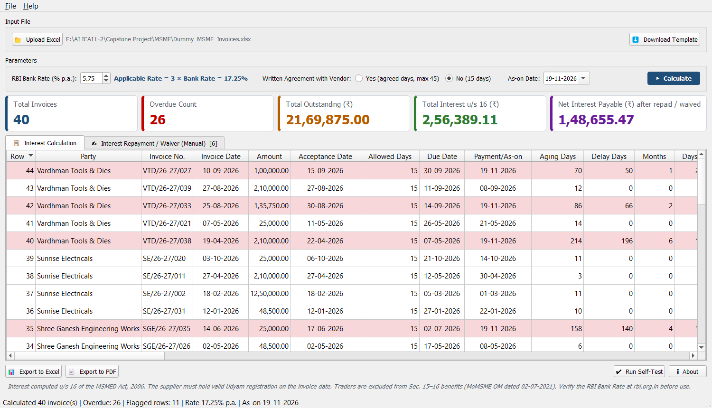

# MSME Interest Calculator

A Windows desktop application that computes interest on delayed payments to Micro and Small Enterprises under **Sections 2(b), 15, 16, 22 and 23 of the MSMED Act, 2006**. It also flags principal that is disallowable u/s **43B(h)** of the Income-tax Act, 1961 (Sec. 37(2)(g) of the Income-tax Act, 2025).

*AICA Level 2 Capstone Project – Batch 111, Pimpri Chinchwad – CA Amir Inamdar*

🎥 **Presentation video:** [Presentation_Video_Amir_Batch111_Pimpri_Chinchwad.mp4](Presentation_Video_Amir_Batch111_Pimpri_Chinchwad.mp4)



## Features

- **Excel / CSV input** with flexible column matching and a downloadable template
- **Due-date logic:** 15 days with no written agreement; agreed credit days (capped at 45) with one
- **Interest u/s 16:** compound interest with monthly rests at 3 × RBI Bank Rate, including part payments on the reducing balance
- **Validation:** invalid dates, zero amounts, payments dated before the invoice, and credit days over 45 are flagged, never dropped
- **Interest Repayment / Waiver tab:** a waiver counts only if the vendor's certificate is available as at the As-on Date
- **Reports:** a formatted Excel workbook (Invoice Detail, Party Summary, Aging, Assumptions, Interest Settlement with Sec. 22 figures) and a PDF report
- **Built-in self-test** of the statutory example (₹1,00,000 → ₹3,576.47 / ₹2,108.65)

## Download and run (no Python needed)

Download **[`MSME_Interest_Calculator.exe`](MSME_Interest_Calculator.exe)** (about 24 MB) from this repository and double-click it. Click the file, then the **Download raw file** button. It is also on the [Releases](../../releases) page.
If Windows SmartScreen appears, click *More info → Run anyway*.

To practise, use the sample files in [`sample_data/`](sample_data/).

## Run from source

```bat
python -m venv venv
venv\Scripts\activate
pip install -r requirements.txt
python MSME_Interest_Calculator.py              :: open the GUI
python MSME_Interest_Calculator.py --selftest   :: run the calculation checks
```

## Build the .exe yourself

```bat
build_exe.bat
```

The exe is written to `dist\MSME_Interest_Calculator.exe`. For details and troubleshooting, see [BUILD_INSTRUCTIONS.md](BUILD_INSTRUCTIONS.md).

## Documentation

- [User Manual (PDF)](docs/MSME_Interest_Calculator_User_Manual.pdf): how to run it, how to maintain the data, and which figures to report (Sec. 22, Schedule III, tax audit, MSME Form I)

## Repository layout

| Path | Contents |
|---|---|
| `MSME_Interest_Calculator.exe` | Ready-to-run Windows program (no Python needed) |
| `MSME_Interest_Calculator.py` | The application: calculation engine, Excel/PDF export, GUI and self-test |
| `requirements.txt` | Python dependencies |
| `MSME_Interest_Calculator.spec`, `build_exe.bat`, `make_icon.py`, `msme.ico` | Files for building the exe |
| `generate_sample_input.py` | Generates a sample input workbook |
| `sample_data/` | Practice input files |
| `sample_output/` | Example Excel and PDF reports |
| `docs/` | User manual and screenshots |

## Disclaimer

Interest is computed u/s 16 of the MSMED Act, 2006. The supplier must hold valid Udyam registration on the invoice date. Traders are excluded from Sec. 15–16 benefits (MoMSME OM dated 02-07-2021). Verify the RBI Bank Rate at rbi.org.in before use.
